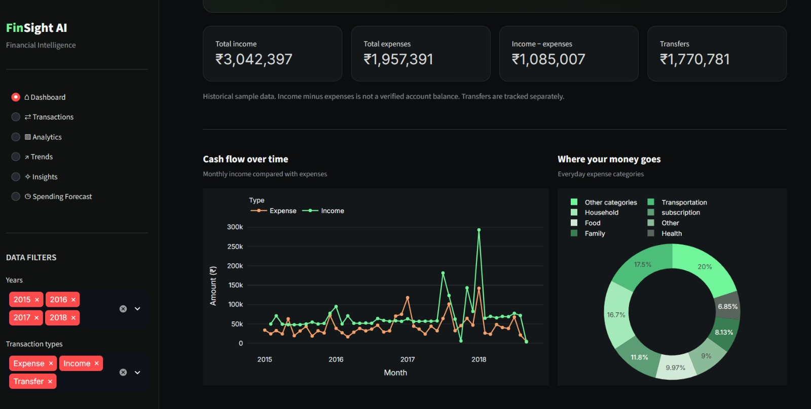
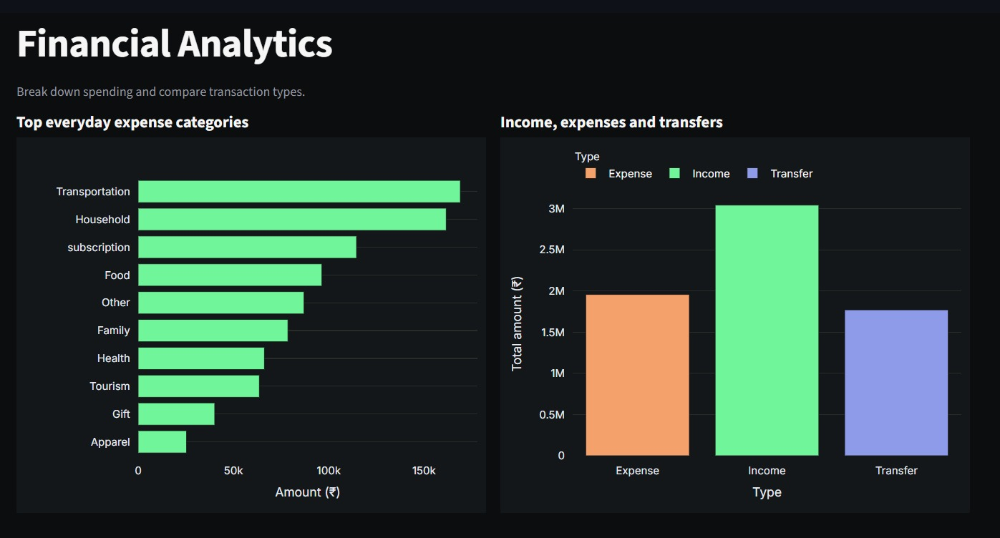
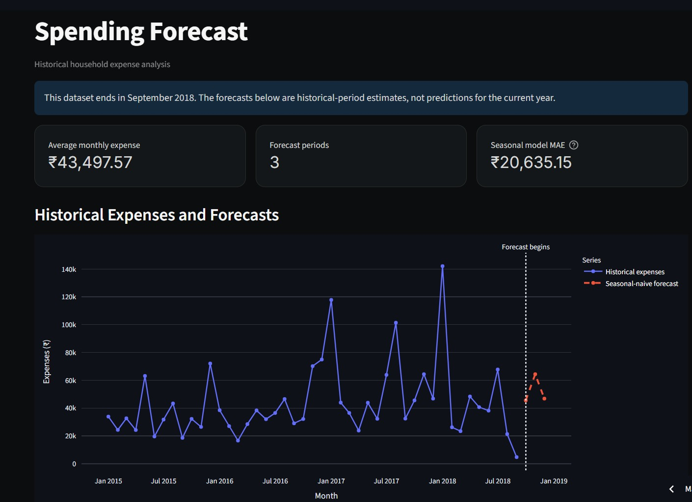

# FinSight AI — Financial Intelligence Dashboard

FinSight AI is a Python-based financial analytics dashboard that explores household transaction data, visualizes spending patterns, identifies potentially unusual expenses, and generates experimental monthly expense forecasts.

## Live Demo

[Open FinSight AI](https://finsight-ai-yamuna.streamlit.app/)

## Dashboard Preview



## Analytics



## Spending Forecast



## Features

- **Financial dashboard:** Summary metrics and visualizations of income and expenses.
- **Transaction explorer:** Search, filter, and download transaction records.
- **Spending analytics:** Category comparisons and transaction-type analysis.
- **Spending trends:** Explore monthly and historical spending patterns.
- **Unusual-spending detection:** Uses Isolation Forest to flag potentially unusual expense transactions for review. Flags are not confirmed fraud.
- **Expense forecasting:** Uses a seasonal-naive method, predicting each month from the corresponding month in the previous year.
- **Model evaluation:** Compares forecasting methods using chronological validation and Mean Absolute Error (MAE).
- **CSV exports:** Download supported transaction and analysis results.

## Technology Stack

- Python
- Pandas and NumPy
- Scikit-learn
- Streamlit
- Plotly
- Matplotlib and Seaborn

## Project Structure

```text
FinSight-AI/
├── dashboard/
│   └── app.py
├── src/
│   ├── inspect_data.py
│   ├── check_dates.py
│   ├── clean_data.py
│   ├── anomaly_detection.py
│   ├── spending_forecast.py
│   └── validate_forecast.py
├── tests/
│   └── test_pipeline_outputs.py
├── data/
│   ├── raw/          # Local dataset; not committed
│   └── processed/   # Generated outputs; not committed
├── requirements.txt
├── .gitignore
└── README.md
```


## Run Locally

1. Clone this repository.
2. Create and activate a Python virtual environment.
3. Install dependencies:

   ```bash
   pip install -r requirements.txt
   ```

4. Place the source CSV at the expected location under `data/raw/`.
5. Clean the data:

   ```bash
   python src/clean_data.py
   ```

6. Generate anomaly results:

   ```bash
   python src/anomaly_detection.py
   ```

7. Generate spending forecasts:

   ```bash
   python src/spending_forecast.py
   ```

8. Run the dashboard:

   ```bash
   streamlit run dashboard/app.py
   ```


## Forecasting Evaluation

The seasonal-naive method estimates a month's expenses using the same calendar month from the previous year. In the current historical evaluation, it achieved a Mean Absolute Error of ₹20,635.15 across 12 test months, compared with ₹32,598.09 for the previous-month baseline.

In a separate multi-window evaluation across 18 historical months, the seasonal-naive method also had the lowest overall MAE among the tested approaches. These results are preliminary and do not guarantee future accuracy.

## Dataset and Limitations

The project uses historical household transaction data covering January 2015 through September 2018. It is not connected to live bank accounts and does not provide real-time financial advice.

The forecasting outputs represent historical-period estimates based on this dataset, not predictions for the current year. The dataset is limited in size, and unusual-spending flags require human review.

## Future Improvements

- Test forecasting performance on additional datasets.
- Improve model validation and explainability.
- Add more configurable spending insights.
- Deploy the dashboard for public demonstration.

## Testing

FinSight AI includes automated tests to verify that the data pipeline generates valid outputs and that the processed datasets contain the expected columns and values.

Activate your virtual environment, then run the following command from the project root:

```powershell
python -m unittest discover -s tests -v
```

The tests check:
- Whether the cleaned transaction dataset exists.
- Whether anomaly detection results are generated.
- Whether spending forecasts contain the expected number of rows, required columns, and valid non-negative values.

A successful run should report that all three tests pass.

**Note:** These tests use locally generated files in `data/processed/`. Run the data-processing scripts first if those files are missing.